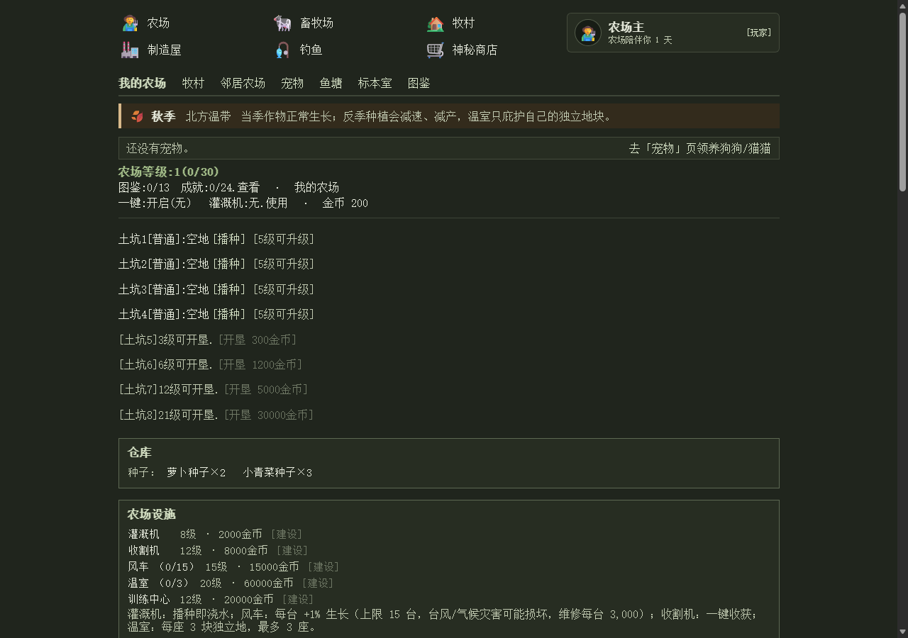

# 🌾 文字农场

纯文字、点链接、按真实时间生长的单机农场。无联网、无充值、无排行榜；作物和农场的名字都由你自己起。

**[▶ 点开就玩（网页版）](https://ksiukee.github.io/text-farm/)** ｜ **[⬇ Windows 桌面版](../../releases/latest)** ｜ **[⬇ macOS 版](../../releases/latest)** ｜ **[⬇ 安卓版 APK](../../releases/latest)**

> 网页版点开就能玩、不用安装，但存档放在你的浏览器里，**会丢**。
> 想长期玩，建议下桌面版——存档是本地文件，自带备份。
>
> **macOS 和安卓版还在适配优化，可能有 bug。** 遇到问题欢迎开 Issue，你的一句话比我自己测十遍有用。

手机浏览器同样能玩（[手机截图](screenshots/mobile.png)），触屏会自己出摇杆和大按键。

## 四个版本怎么选

|  | 网页版 | Windows | macOS | 安卓 |
|---|---|---|---|---|
| 安装 | 不用，点开就玩 | 下载 exe，双击运行 | 下载 dmg，拖进应用文件夹 | 下载 APK 安装 |
| 存档在哪 | 你浏览器的 IndexedDB | 本机文件 | 本机文件 | 本机文件 |
| 换设备 | 手动导出 / 导入 | 手动导出 / 导入 | 手动导出 / 导入 | 手动导出 / 导入 |
| 会丢档吗 | **会**，见下一节 | 很少（自带 `.bak` + 10 份轮转备份） | 同左 | 同左 |
| 成熟度 | 稳 | 稳 | **适配中，可能有 bug** | **适配中，可能有 bug** |
| 适合 | 试玩、随手点两下 | 长期玩 | 长期玩 | 手机上长期玩 |

**存档格式三端完全一样**：都是同一份 JSON，带 schema 版本和自动迁移。网页版导出的档可以直接导进桌面版，反过来也行。

> **macOS 第一次打开**：没买 Apple 开发者账号（$99/年），系统会提示「无法验证开发者」。
> 右键点图标 →「打开」→ 再点一次「打开」，只需要做一次。

## ⚠️ 网页版会丢档，请当它随时会没

网页版没有服务器，存档只存在**你当前这个浏览器**里。下面这些情况都会丢：

- 清理浏览器「Cookie 及其他网站数据」
- 用无痕 / 隐私窗口，窗口一关就没了
- 换浏览器、换电脑、换手机
- **iPhone / iPad 的 Safari：7 天没打开过这个站，系统会清掉网页存储**（「添加到主屏幕」能缓解，但不保证）
- 以后本站如果换了域名，旧域名下的档读不到（存储跟着域名走）
- 网页版升级时存档迁移失败（有备份槽，但极端情况仍要靠你手上的导出文件）

**所以：网页版请每次玩完点一次「设置 → 导出存档」**，把下载下来的 json 存到网盘或微信收藏。
换设备时，在新设备打开网页版 →「设置 → 导入存档」→ 选那个 json，农场就回来了。

嫌麻烦就用桌面版：存档是本地文件，不用你手动搬。

## 游戏里有什么

- **种植**：13 种作物、四季与反季惩罚、旱涝冰雹霜冻病害、土地三档升级
- **牧场**：鸡鸭牛羊、繁殖与品质、畜栏扩建
- **鱼塘**：鱼苗、投喂、氨氮、订单
- **钓鱼**：手感小游戏（框速/惯性/张力条）、鱼竿、鱼饵、鱼王、图鉴
- **制造屋**：原料 → 加工品，槽位与设备升级
- **宠物**：13 个品种、各自性格与主动技能、寄养
- **邻居**：5 个 NPC 农场、帮忙浇水、偷菜、回访留言、友好度
- **其它**：订单、图鉴、成就、每日签到、节日与庙会、神秘商店、小屋装修

## 常见问题

**网页版第一次打开有点慢？**
要下 0.75 MB 的 wasm（gzip 后）加素材。之后走浏览器缓存，第二次很快。

**Windows 提示「已保护你的电脑」？**
exe 没买代码签名证书。点「更多信息 → 仍要运行」。介意的话可以自己从源码构建。

**桌面版存档在哪？**
`%APPDATA%\app.textfarm.desktop\save.json`，旁边有 `save.json.bak` 和 `backups/`（最近 10 份）。
设置里也能导出/导入。

**数据会上传到哪吗？**
不会。没有服务器、没有账号、没有统计、没有广告。所有东西都在你本机。

**能改名字吗？**
能。作物名、农场名、角色名都能在游戏里改，也能导出内容包分享给别人。

**存档能从旧版本带过来吗？**
能，存档有 schema 迁移。但反过来不行：新版本的档在旧版本里打不开。

## 版本

当前版本：**0.139.0**（完整历史见 [CHANGELOG](CHANGELOG.md)，每个版本的详细说明见 [Releases](../../releases)）

## 反馈与支持

- **Bug、功能建议**：[开个 Issue](../../issues) —— 能搜索、能跟踪，处理最快。写清楚：哪个版本（网页 / 桌面 / 安卓）、什么系统、怎么复现。
- **想打赏、或者只想私下说两句**：[爱发电](https://afdian.com/a/siukee)，任意金额，留言里写就行。
- 这里不放邮箱：不是不欢迎，是怕被爬虫轰炸。

## 自己构建

展开

- 桌面版：`cargo tauri build --no-bundle`（产物在 `target/release/`）
- 网页版：`.\scripts\web-build.ps1`（产物在 `app/frontend/dist/`，整个目录就是网页版）
- 安卓：`.\scripts\android-build.ps1 -Arch aarch64 -Release -Aab`

架构：Rust 领域内核（`crates/farm-core`，零 Tauri / 零文件系统 / 零系统时间）+ Tauri 2 壳 + Vue 3 前端；网页版用一个 wasm 壳（`crates/farm-wasm`）复用同一份内核。

## 许可

- **代码**：GPL-3.0-or-later（全文见 [LICENSE](LICENSE)）
- **美术素材与文案**：CC BY-NC-SA 4.0 —— 可转载、可修改，不得商用，需署名并以相同方式共享

商用授权、或者就想聊聊这个项目，开个 Issue 就行。第三方依赖与素材来源见 [THIRD_PARTY_NOTICES.md](THIRD_PARTY_NOTICES.md)。
